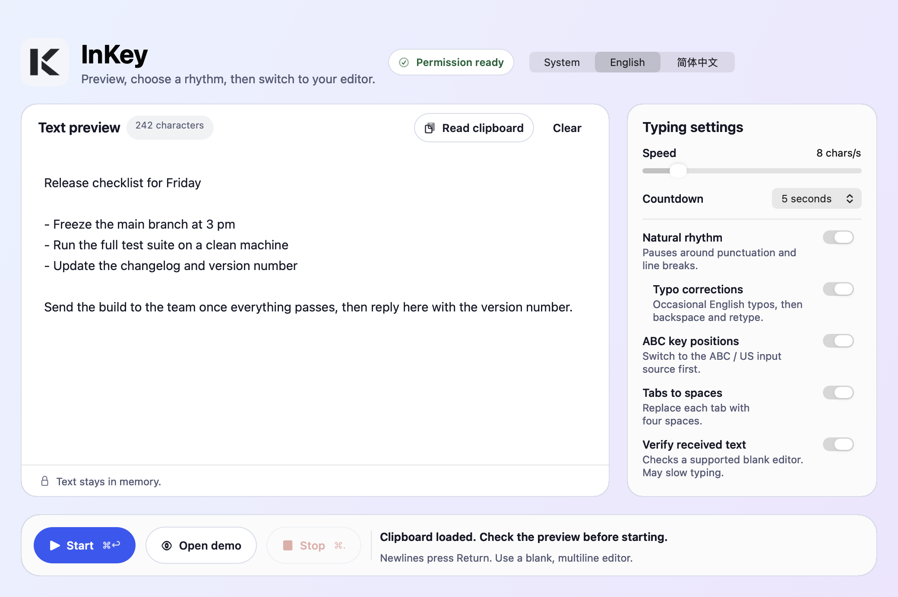

  

  <h3>Your clipboard, at your pace.</h3>

  
Review your text. Choose a rhythm. Bring it into your editor, one keystroke at a time.

  
<strong>macOS 13+</strong> · Apple Silicon · English / Simplified Chinese · Local by design

  

    <a href="https://github.com/danielloong714/InKey/releases/latest"><strong>Download for macOS</strong></a>
    &nbsp;·&nbsp;
    <a href="https://github.com/danielloong714/InKey/issues">Report a bug</a>
  

 

<picture>
  <source media="(prefers-color-scheme: dark)" srcset="docs/assets/preview-dark.png">
  <source media="(prefers-color-scheme: light)" srcset="docs/assets/preview-light.png">
  
</picture>

Native interface previews with sample text. Light and dark appearances follow your GitHub theme.

## A moment to review. Then let it type.

1. **Read.** Select **Read clipboard** to load plaintext. Nothing is read in the background.
2. **Review.** Edit the preview, choose your settings, or try **Open demo** inside InKey. The demo sends no keys to other apps.
3. **Start.** Begin the countdown, switch to a blank multiline editor and place the caret. Stop from InKey's menu bar, or switch away from the target app.

## Make the pace your own

| Feature | What it does |
| --- | --- |
| Adjustable timing | Choose 3–40 characters per second and a 3–15-second countdown. Defaults are 8 characters per second and 5 seconds. |
| Natural rhythm | Optional variation and pauses around punctuation and line breaks. |
| English typo corrections | Optionally type a neighboring letter, backspace once, then retype the original. |
| Received-text verification | Compare plaintext in a supported editor and repair a bounded new tail. |
| Native controls | A clear preview, countdown, progress and stop states, with light/dark appearance and English or Simplified Chinese UI. |

## Install

Get the Apple Silicon download from [Releases](https://github.com/danielloong714/InKey/releases/latest), open the DMG, and drag **InKey.app** to **Applications**.

This release is **ad-hoc signed and not notarized**, without Apple Developer ID signing. macOS may require a security review before opening it. InKey does not disable system protections.

For typing into another app, select **Review permission** and follow the macOS Accessibility prompt. With **ABC key positions** enabled, use the ABC / US input source. Test a short sample before a longer run.

## Your text stays local

InKey reads the clipboard only when you ask. Typing text stays in memory: no uploads, telemetry, background clipboard watcher or global keylogging. Only your interface language preference is remembered.

<strong>What does verification confirm?</strong>

Verification requires a readable, initially blank multiline editor exposing an Accessibility text area (AXTextArea), with the caret at the end. Some browser editors and VS Code configurations do not expose the required data. InKey stops before typing when the target is unsupported; disable verification to use standard typing instead.

**Sent** means keyboard events reached macOS. **Verified** means plaintext matched at that moment. Neither confirms formatting, saving or later edits. You still check and save the result yourself. Verification and natural pauses can reduce the effective speed.

Automated checks and native offscreen previews do not replace a hands-on test of external-editor input or the permission flow. Stopping during a correction may leave a temporary typo; check the end of your text.

## Feedback & availability

Found a problem? [Open an issue](https://github.com/danielloong714/InKey/issues) with your macOS version, target editor and a short example. Do not include private clipboard content.

This is the public showcase and distribution repository: documentation, screenshots and releases. **InKey is closed-source; its source code is maintained privately.** See [LICENSE](LICENSE.md) for usage and distribution terms.

GitHub's automatic source archives contain this product page and its assets, not the private application code.
